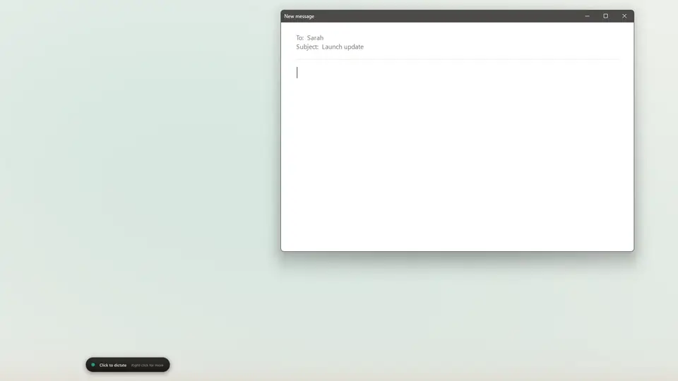
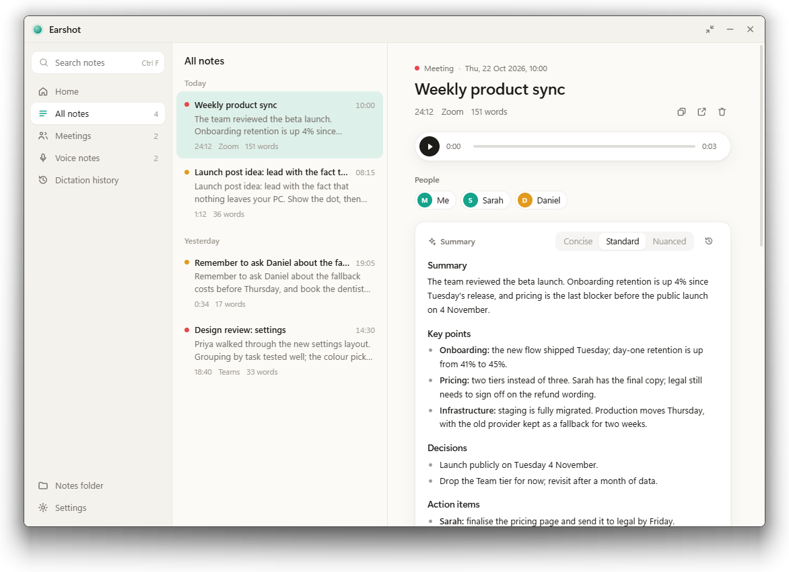
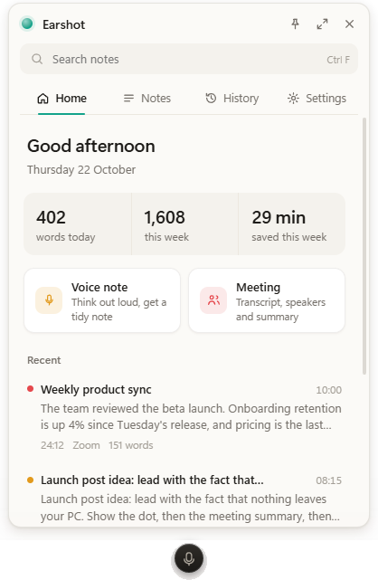
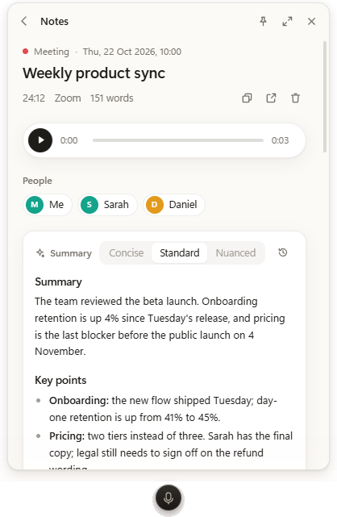
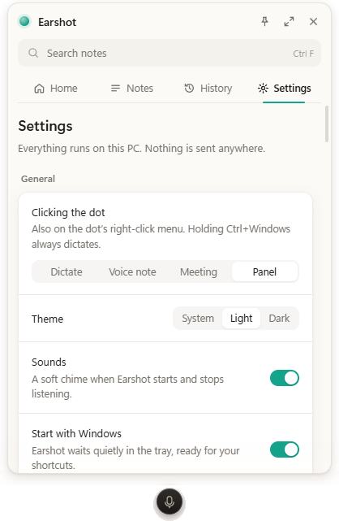
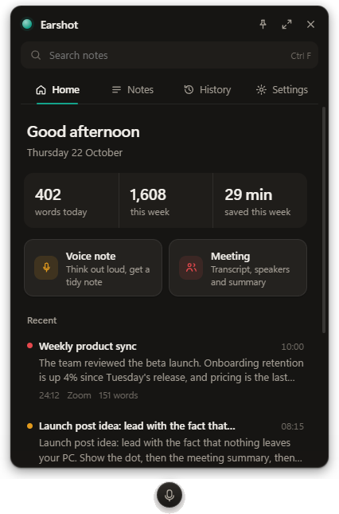

<h1 align="center"><br>Earshot</h1>

<p align="center"><b>A free, open-source Wispr Flow alternative for Windows that runs entirely on your PC.</b></p>

<p align="center"><a href="https://github.com/Jestersheepy/earshot/releases/latest"></a></p>

<p align="center"><sub>64-bit Windows 11 (Windows 10 should work but is untested). Free, no account. <a href="#install">Install notes</a></sub></p>

<p align="center"><a href="https://ko-fi.com/thedreamingjester"></a></p>

Dictation, voice notes and meeting notes, with the speech recognition and the AI clean-up running on your own CPU. No account, no subscription, no cloud server: your voice never leaves your machine.

- **Offline and on-device.** Speech-to-text, formatting, command mode and meeting summaries all run locally. After the one-time model download, Earshot works with the network unplugged.
- **No cloud connection.** Nothing is uploaded and there's no telemetry. If you'd rather have a cloud model write your meeting summaries, you can add your own Claude or OpenAI API key; it's off by default.
- **Free and open source.** MIT licensed, with no usage caps and no "Pro" tier.
- **Polished.** A small floating dot, a panel that opens right beside it and expands into a full window, light and dark themes, soft start and stop chimes. It's built to feel like a finished app rather than a script with a tray icon.
- **Light.** About 18 MB of memory and practically no CPU while it waits. See [Footprint](#footprint).

<p align="center"><a href="docs/earshot-demo.mp4"></a><br>
<sub>The voice is <a href="https://gradium.ai/phonon">Phonon</a> text-to-speech fed into Earshot as its mic. <a href="docs/earshot-demo.mp4">Watch with sound (MP4)</a></sub></p>

## What it does

- **Dictate**: hold **Ctrl+Win**, speak, release. The text is pasted wherever your cursor is, tidied by a small local model (fillers, "no wait, Thursday", spoken lists). Double-tap to keep it listening hands-free; clicking the dot does the same by default.
- **Command mode**: select text, hold **Ctrl+Win+Alt** and say what to do ("make this friendlier", "turn this into bullets"). With nothing selected, it writes new text.
- **Paste last**: **Alt+Shift+V** pastes your latest dictation again. Every dictation is kept in History.
- **Voice note**: **Ctrl+Alt+N** to start and stop. Saved as Markdown with the audio alongside, given a title, and sorted into note, to-do, idea or reminder; to-dos with a day ("by Monday") become dated tasks.
- **Meeting notes**: **Ctrl+Alt+M**, or say Record when Earshot spots Zoom, Teams, Slack, Discord, Webex or a browser call using your mic. Voices are told apart (you, Speaker 1, 2, …); name someone once and Earshot recognises their voice next time. You get a timestamped transcript and a local summary at the depth you choose: Concise, Standard (every action item) or Nuanced (also what was left unsaid, with suggested next steps). Each meeting also gets a title, a one-line gist, chapters you can jump to, and its action items as a checklist (owner and due date). Recording stops by itself when the call ends.
- **Tasks**: every action item and to-do across your notes in one list, grouped by person. Tick them off (the note's checklist ticks too, Obsidian-style) or add a dated one to your calendar.
- **Search by meaning**: type to match words instantly, press Enter to search by meaning, or ask out loud with **Ctrl+Alt+F**. "What did Sarah say about pricing last week" narrows to Sarah and last week, and results open at the moment it was said.
- **The dot**: right-click for notes, meetings and what a click does (dictate, voice note, meeting or the panel). Its size, idle style, accent colour and hover hint are yours to choose.
- **Panel**: double-click the dot (or use the tray) and a compact panel opens beside it: today's stats, recent notes, search, dictation history and settings. Expand it into a full window when you want more room.

Everything runs on the CPU with no network calls. Only the one-time model download needs the internet. The one exception is opt-in: Settings › Meetings can send transcripts to Claude, OpenAI or any OpenAI-compatible server for summaries, using your own API key (kept in Windows Credential Manager).

| Part | What | Disk | RAM |
|---|---|---|---|
| Speech-to-text | [Underdog Bark 3.0 Plus](https://huggingface.co/ConwayResearch/Underdog-Bark-3.0-Plus), int8 ONNX encoder, Rust TDT decoder | 890 MB | about 900 MB while loaded; unloaded after 15 minutes idle |
| Formatting, command mode | [LFM2-1.2B](https://huggingface.co/LiquidAI/LFM2-1.2B-GGUF) Q4_K_M through llama.cpp's `llama-server` | 730 MB | about 1 GB, kept warm 5 minutes after use |
| Summaries | [Qwen3-4B-Instruct-2507](https://huggingface.co/Qwen/Qwen3-4B-Instruct-2507) Q4_K_M, same server | 2.5 GB | about 3–4 GB, only while summarizing |
| Speakers | [CAM++](https://github.com/modelscope/3D-Speaker) voice embeddings (sherpa-onnx export), same ONNX Runtime | 28 MB | a few MB, only while saving a meeting |
| App | Rust + Tauri; the dot, menu and pop-ups are drawn natively, the panel is WebView2 only while open (freed 3 minutes after closing) | ~20 MB | about 18 MB idle |

## Screenshots



<table>
<tr>
<td></td>
<td></td>
</tr>
<tr>
<td align="center">Home: today's stats and recent notes, right beside the dot</td>
<td align="center">A meeting with its speakers and summary</td>
</tr>
<tr>
<td></td>
<td></td>
</tr>
<tr>
<td align="center">Settings</td>
<td align="center">Dark mode</td>
</tr>
</table>

## Footprint

Earshot keeps almost nothing in memory until you use it. Measured on Windows 11 (Ryzen 9 7950X3D):

| | Memory | When |
|---|---|---|
| Waiting in the background | **about 18 MB** (6 MB private), about 0.1% CPU | Always. The dot, menu and pop-ups are drawn natively, with no browser engine running. |
| Speech model | about 900 MB | Loaded for instant dictation, then unloaded after 15 minutes idle. Turn off "Load speech model at startup" to load it only when you first dictate. |
| Formatting model | about 1 GB | While tidying a dictation, then kept warm for 5 minutes. |
| Summary model | about 3–4 GB | Only while summarising a meeting. Not needed at all if you use a cloud key. |
| Panel | WebView2 | Only while open; freed 3 minutes after you close it. |

Everything runs on the CPU, so no GPU is needed. The installer is 18 MB; the models are downloaded once on first launch.

## Install

Download `Earshot_<version>_x64-setup.exe` from the [latest release](https://github.com/Jestersheepy/earshot/releases/latest) and run it. Built and tested on 64-bit Windows 11; Windows 10 should work but is untested. It installs per user (no admin rights), adds a Start menu entry, and starts Earshot with Windows (turn that off in Settings). The installer is small; on first launch Earshot downloads its models (about 1.6 GB, plus 2.5 GB for summaries on this PC, which you can skip if you use a cloud model). Downloads resume if interrupted and each file is checked against its SHA-256 (`src-tauri/src/setup.rs`).

Uninstall from Windows Settings > Apps. Tick "Delete the application data" to also remove the models, settings and dictation history; your notes in `Documents\Earshot` are never touched.

The installer isn't code-signed yet, so SmartScreen asks for confirmation the first time ("More info" > "Run anyway").

**Developing.** `tools/install_models.py` hard-links the repo's `models/` into `%LOCALAPPDATA%\Earshot\models`, so a fresh build skips the download. The speech model is served from this repo's `models-v1` release; publish a new export there and update the hashes in `setup.rs`. For demo recordings, set `EARSHOT_MIC_WAV` to a WAV file (or a folder of them, used in name order) and Earshot plays it as the mic instead of the real one.

## Models

```bash
uv venv -p 3.12 .venv
uv pip install -p .venv -r tools/requirements.txt
.venv/Scripts/python tools/download_models.py
```

**One-time Bark export.** This needs torch once; the app never uses it. Run it in a throwaway venv you can delete afterwards:

```bash
uv venv -p 3.11 .venv-export
uv pip install -p .venv-export --index-url https://download.pytorch.org/whl/cpu --extra-index-url https://pypi.org/simple torch==2.8.0 transformers==5.19.0 constriction==0.5.0 numpy soundfile soxr librosa==0.11.0 onnx onnxruntime safetensors
.venv-export/Scripts/python tools/export_bark_onnx.py models/bark-src models/bark-onnx
```

## Build

Needs Rust (stable MSVC), Node and pnpm.

```bash
pnpm install
pnpm tauri dev                     # debug build; uses ./models if AppData has none
pnpm tauri build                   # installer in target/release/bundle/nsis/ (bundles ./models/llama.cpp)
.venv/Scripts/python tools/make_icons.py   # after editing src-tauri/icons/*.svg
```

Checks:

- `cargo test -p earshot-core` includes the golden test: the Rust transcripts must match `tools/reference_stt.py` exactly (`tools/make_golden.py` writes the reference).
- `cargo test -p earshot --lib` covers formatting, history and the notes library; `pnpm check` type-checks the window.
- `cargo run -p earshot --example format_spike --release` scores formatting models on `tools/format_cases.json`.

## Files

- Settings: `%APPDATA%\Earshot\config.json` (edit them in the window).
- Notes: `Documents\Earshot\Voice Notes` and `Meetings`, as `YYYY-MM-DD HHMM.md` plus audio. They work with Obsidian.
- Dictation history: `%APPDATA%\Earshot\history.db`.

## Notes and limits

- Bark is English only.
- Without headphones, the mic hears the call. Earshot mutes mic frames while the other side is louder, and drops "Me" lines that repeat an "Others" line.
- Elevated (admin) windows only accept pasted text if Earshot also runs elevated.
- Only text clipboard content is restored after a dictation paste.

## Support

Got use out of it? Feel free to [grab me a coffee](https://ko-fi.com/thedreamingjester). Bug reports and pull requests are welcome too.

## Licence

Earshot's code is released under the [MIT licence](LICENSE). The models it downloads keep their own licences: Underdog Bark 3.0 Plus (CC BY 4.0), LFM2-1.2B (LFM Open License v1.0), Qwen3-4B-Instruct-2507 (Apache 2.0) and CAM++ (Apache 2.0). The bundled llama.cpp and ONNX Runtime are MIT licensed.
